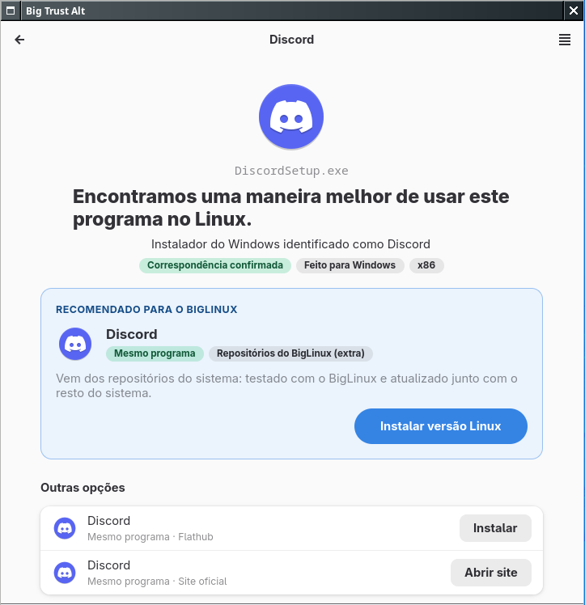
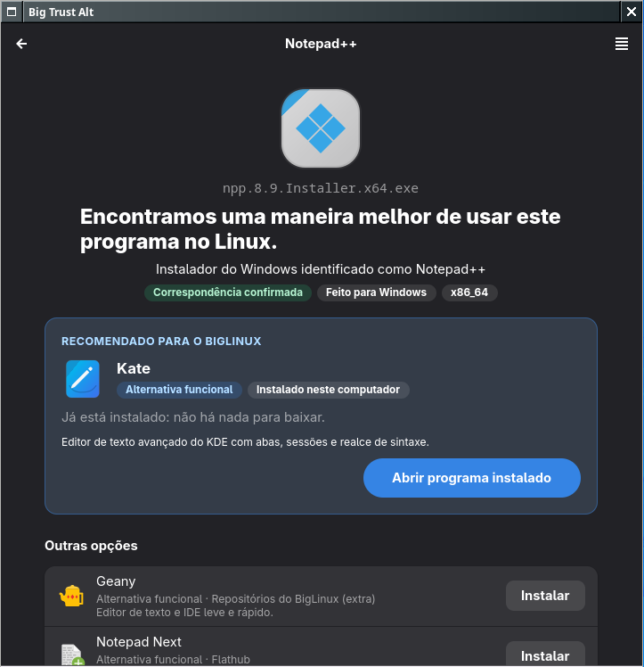
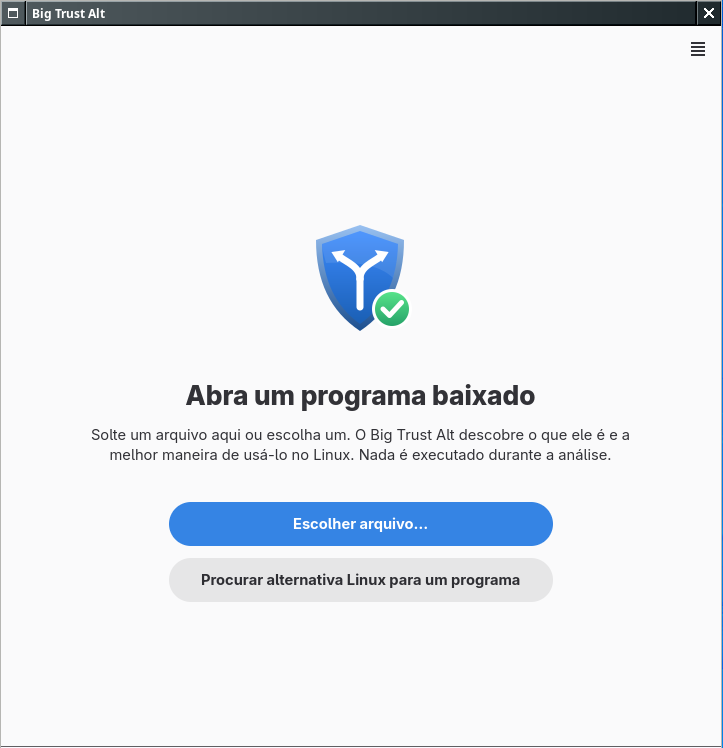
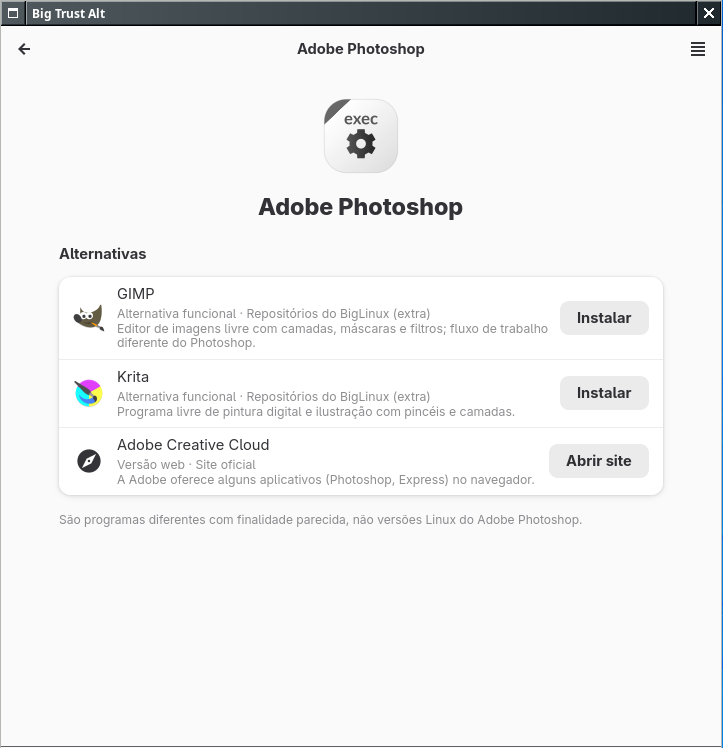
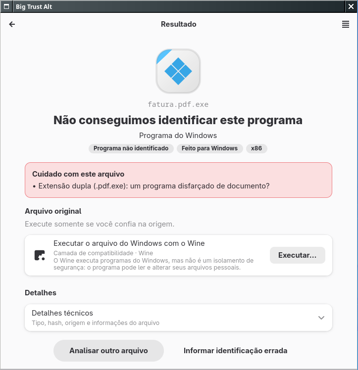
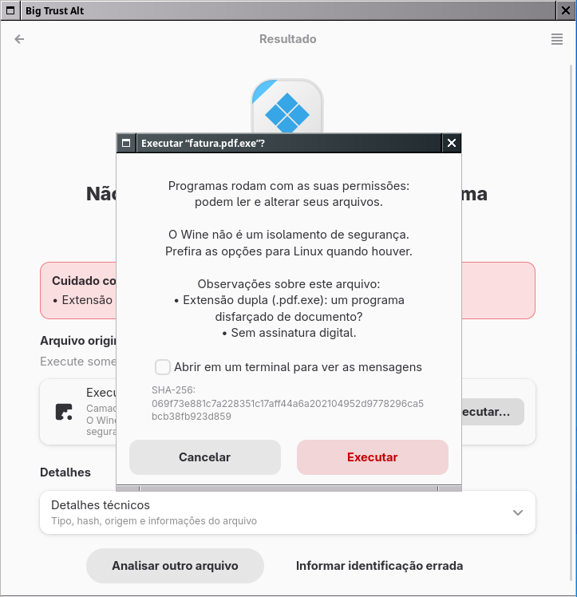
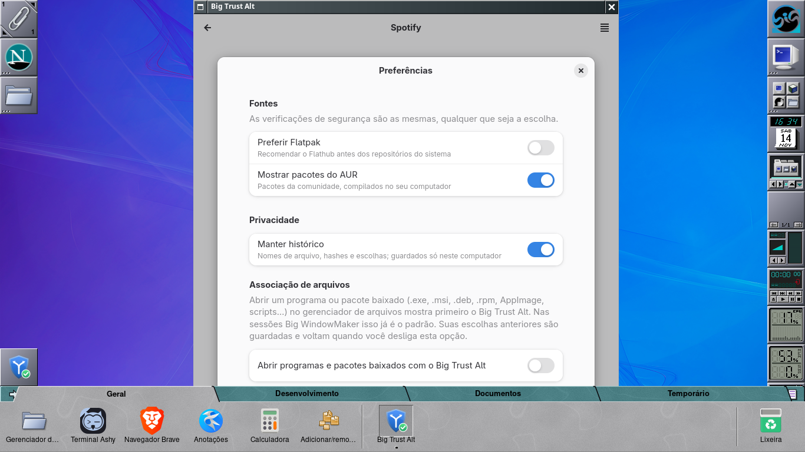
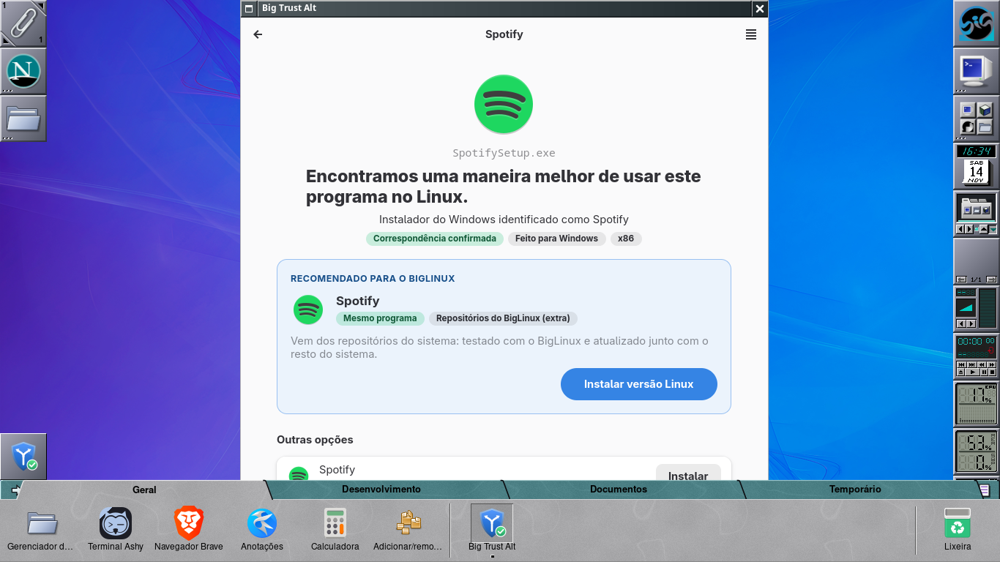

<p align="center">
  
</p>

<h1 align="center">Big Trust Alt</h1>

<p align="center">
  <b>A maneira inteligente de abrir, instalar e encontrar alternativas para programas no Linux.</b><br>
  Parte do <a href="https://github.com/big-windowmaker">Big WindowMaker</a> · feito para o <a href="https://www.biglinux.com.br">BigLinux</a>
</p>

<p align="center">
  <a href="https://github.com/big-windowmaker/big-trust-alt/actions/workflows/ci.yml"></a>
  <a href="https://github.com/big-windowmaker/big-trust-alt/tags"></a>
  
  
  
</p>

---

Você baixou `ChromeSetup.exe`, `DiscordSetup.exe` ou `npp.8.9.Installer.x64.exe` e deu dois cliques.
Em vez de um erro, ou de o Wine abrir sem perguntar nada, o **Big Trust Alt** mostra **o que o arquivo é**
e **a melhor maneira de ter esse programa no BigLinux**: o pacote dos repositórios, o Flatpak, o
AUR, o download oficial para Linux, um programa diferente com a mesma finalidade ou, se você
escolher, o próprio arquivo com o Wine.

**Nada é executado durante a análise.**

<table>
  <tr>
    <td width="50%"></td>
    <td width="50%"></td>
  </tr>
  <tr>
    <td align="center"><sub>Um instalador do Windows com versão Linux: instala dos repositórios</sub></td>
    <td align="center"><sub>Sem versão Linux: uma alternativa honesta (aqui, já instalada), no tema escuro</sub></td>
  </tr>
</table>

## 📑 Sumário

- [O que ele faz](#-o-que-ele-faz)
- [Capturas](#-capturas)
- [X11 e Wayland](#-x11-e-wayland)
- [Instalação](#-instalação)
- [Uso](#-uso)
- [Como funciona](#-como-funciona)
- [Contribuir](#-contribuir)
- [Agradecimentos](#-agradecimentos) · [Licença](#-licença) · [English](#english)

## ✨ O que ele faz

| | |
|---|---|
| 🔎 **Identifica pelo conteúdo, não pela extensão** | Lê os dados internos de `.exe` (version info, .NET, assinatura, tipo de instalador), `.msi`, `.msix/.appx`, `.deb`, `.rpm`, AppImage, pacotes do Arch, `.jar`, scripts (`.sh`, `.bat`, `.cmd`, `.ps1`), `.flatpakref` e arquivos compactados, sem executá-los nem extraí-los. |
| 🧭 **Recomenda o melhor caminho para o BigLinux** | Mostra se você já tem o programa, se ele está nos repositórios, no Flathub, no AUR, no Steam ou no site oficial, e explica o porquê. |
| 🔁 **Mostra alternativas honestas** | O Photoshop leva ao GIMP e ao Krita, com o aviso de que *não são* o Photoshop. Lançadores de jogos levam ao Heroic, ao Lutris ou ao Steam. |
| 🛡️ **Avisa sobre o que importa** | Extensão falsa (`fatura.pdf.exe`), nome com caracteres invisíveis, programa sem assinatura ou feito para outro processador, script que baixa e executa código, ou arquivo que mudou depois da análise. |
| 🍷 **Não tira a sua escolha** | O Wine, o Bottles (Flatpak) e a execução do próprio arquivo continuam à vista, sempre com confirmação, o SHA-256 e o aviso de que o Wine não isola nada. |
| 📦 **Integra o que o BigLinux já tem** | O Pamac instala dos repositórios e compila do AUR, com a revisão da transação. O Flatpak instala do Flathub, com progresso real. O [big-pkg-installer](https://github.com/biglinux/big-pkg-installer) converte `.deb/.rpm`, mas só depois de mostrar se há um pacote nativo. |
| 🌐 **Funciona sem internet** | Com o catálogo local (358 entradas) e os repositórios do sistema. Só o AUR consulta a rede, e dá para desligar. |
| 🔒 **Privado** | Nada é enviado. O histórico fica só no seu computador e guarda apenas o nome do arquivo, o hash e a escolha. |

## 📸 Capturas

Capturas de 14/11/2026 (versão 0.1.1), num servidor X próprio (Xvfb) com a
sessão do Big WindowMaker: Window Maker no X11 e wlmaker aninhado no
Wayland. Os arquivos analisados são de teste, gerados pelos mesmos
construtores da suíte (`tests/builders.py`); nada foi executado.

| | | |
|---|---|---|
|  |  |  |
| Início: solte um arquivo ou procure uma alternativa | Sem arquivo: alternativas para o Photoshop | Extensão dupla: o aviso vem antes de tudo |

| | |
|---|---|
|  |  |
| Executar o próprio arquivo sempre pede confirmação | Preferências (Wayland): fontes, privacidade e associação de arquivos |

<p align="center">
  
</p>
<p align="center"><sub>O mesmo fluxo na sessão Wayland do Big WindowMaker (wlmaker), com a moldura do compositor.</sub></p>

## 🖥️ X11 e Wayland

O Big Trust Alt é um aplicativo GTK4 + libadwaita comum: não depende de
KDE, GNOME nem de um compositor, e o comportamento é o mesmo nas duas
sessões.

| | X11 (Window Maker) | Wayland (wlmaker) |
|---|---|---|
| Moldura | a do Window Maker (sem CSD) | a do wlmaker |
| Análise, recomendação, alternativas, confirmação | ✅ | ✅ |
| Abrir pelo gerenciador de arquivos | ✅ (`windowmaker-mimeapps.list` do big-wm põe o Big Trust Alt primeiro) | ✅ (`wlmaker-mimeapps.list`) |
| Arrastar e soltar na janela | implementado; não verificado com um gerenciador de arquivos de verdade | idem |
| Pamac e Flatpak (Polkit) | delegados a eles; não verificados no laboratório | idem |

Fora das sessões do Big WindowMaker, instalar não muda nenhum padrão: a
opção *Abrir programas e pacotes baixados com o Big Trust Alt* das
Preferências (ou `--associate`) grava o padrão em `~/.config/mimeapps.list`
e guarda os anteriores; desligar (`--dissociate`) devolve tudo. Detalhes
em [Wayland e X11](docs/08-wayland-x11.md).

## 📥 Instalação

### Pacote (BigLinux, Manjaro, Arch)

O PKGBUILD fica em [`pkgbuild/PKGBUILD`](pkgbuild/PKGBUILD) e compila a
tag da versão (`v0.1.1`); `BIG_TRUST_ALT_SOURCE` troca a fonte por um clone
local:

```bash
git clone https://github.com/big-windowmaker/big-trust-alt.git
cd big-trust-alt/pkgbuild
makepkg -si
```

| Pacote | Para quê |
|---|---|
| `python`, `python-gobject`, `gtk4`, `libadwaita`, `glib2`, `pango` | a janela (GTK4 + libadwaita) |
| `pacman` | o que está instalado e nos repositórios (`pacman -Qq` / `-Sl`) |
| `hicolor-icon-theme` | ícones |
| `pamac-gtk` (opcional) | instalar dos repositórios e do AUR com revisão da transação (`pamac-installer`) |
| `flatpak` (opcional) | aplicativos do Flathub; o Bottles também vem por ele |
| `big-pkg-installer` (opcional) | converter e instalar `.deb` e `.rpm` |
| `wine` (opcional) | executar programas do Windows, por escolha sua |
| `jre-openjdk` (opcional) | executar aplicativos Java (`.jar`) |
| `steam` (opcional) | abrir na loja do Steam os jogos que têm versão para Linux |

Para compilar: `git` e `gettext`; para os testes, `python-pytest`.
Remover: `sudo pacman -R big-trust-alt` (as preferências ficam em
`~/.config/big-trust-alt/` e o histórico em `~/.local/state/big-trust-alt/`).

### Direto do código (sem instalar)

```bash
make build                       # compila as traduções
PYTHONPATH=src python3 -m big_trust_alt ~/Downloads/ChromeSetup.exe
```

## 🚀 Uso

- **Dois cliques** num programa ou pacote baixado (`.exe`, `.msi`, `.deb`, `.rpm`, AppImage, scripts…) no gerenciador de arquivos. Nas sessões Big WindowMaker ele já é o primeiro; em outros desktops, ligue *Preferências → Abrir programas e pacotes baixados com o Big Trust Alt*.
- **Arraste** um arquivo para a janela, ou use *Abrir arquivo…*.
- **Sem arquivo:** *Procurar alternativa…*, por exemplo "Photoshop" ou "WinRAR".

| Atalho | Ação |
|---|---|
| `Ctrl+O` | Abrir arquivo |
| `Ctrl+F` | Procurar alternativa |
| `Ctrl+H` | Histórico |
| `Ctrl+,` | Preferências |

No terminal:

```bash
big-trust-alt ~/Downloads/DiscordSetup.exe                  # abre a janela com o resultado
big-trust-alt --analyze ~/Downloads/DiscordSetup.exe        # resultado legível
big-trust-alt --analyze arquivo.msi --json --offline         # JSON, sem consultar o AUR
big-trust-alt --search "notepad++"
big-trust-alt --associate | --dissociate | --associations
big-trust-alt --diagnostics                                  # relatório sem dados pessoais
```

```console
$ big-trust-alt --analyze DiscordSetup.exe
DiscordSetup.exe
  Tipo: Instalador do Windows · x86
  Identificação: Correspondência confirmada — Discord
  [warning] Sem assinatura digital.
  Recomendado: Discord — Repositórios do BigLinux (extra)
   - Mesmo programa: Discord · Flathub
   - Mesmo programa: Discord · Site oficial
   - Camada de compatibilidade: Executar o arquivo do Windows com o Wine · Wine
```

## 🧩 Como funciona

```
arquivo ─▶ detectores (só leitura) ─▶ catálogo + pontuação ─▶ provedores (pacman, Flatpak, AUR, instalados)
        ─▶ opções ordenadas + recomendada ─▶ janela ou JSON ─▶ ação escolhida (Pamac, Flatpak, big-pkg-installer, Wine)
```

- **Catálogo:** 358 entradas verificadas em `data/app-db/catalog/`, com esquema versionado e validado (`tools/validate_catalog.py`).
- **Correspondência:** confirmada, provável, ambígua (você escolhe) ou não identificada.
- **Documentação técnica** em [`docs/`](docs/):

| | | |
|---|---|---|
| [Pesquisa](docs/01-research.md) | [Arquitetura](docs/02-architecture.md) | [Segurança](docs/03-security.md) |
| [Catálogo](docs/04-app-database.md) | [Detecção](docs/05-file-detection.md) | [Provedores](docs/06-package-providers.md) |
| [Interface](docs/07-ux-ui.md) | [Wayland e X11](docs/08-wayland-x11.md) | [Testes](docs/09-tests.md) |
| [Instalação](docs/10-installation.md) | [Próximos passos](docs/11-roadmap.md) | [Relatório da 0.1](docs/12-final-report.md) |

## 🤝 Contribuir

O jeito mais útil de ajudar é **melhorar o catálogo**. Encontrou um programa que não foi
reconhecido, ou foi reconhecido errado?

1. No resultado, clique em **Informar identificação errada**. O relatório (sem pastas nem dados pessoais) vai para a área de transferência.
2. Abra uma [issue](https://github.com/big-windowmaker/big-trust-alt/issues/new/choose) com ele, ou corrija o JSON em `data/app-db/catalog/` e abra um PR.

Para código, veja [CONTRIBUTING.md](CONTRIBUTING.md). Antes do PR:

```bash
make check     # catálogo + 76 testes
make lint      # ruff
```

Para testar a interface sem mexer na sua sessão: um Xvfb com o Window
Maker, ou o wlmaker aninhado, com HOME descartável
([Testes](docs/09-tests.md)).

## 🙏 Agradecimentos

- **[Zorin Exec Guard](https://github.com/ruscher/zorin-exec-guard)** e **[Zorin Exec Guard App DB](https://github.com/ruscher/zorin-exec-guard-app-db)**, da Zorin OS Technologies Ltd. (GPL-3.0+ / GPL-2.0+). A ideia original e a base de 241 mapeamentos: 247 das nossas entradas partiram dela, reescritas e conferidas.
- **[big-pkg-installer](https://github.com/biglinux/big-pkg-installer)** e **[big-executable](https://github.com/biglinux/big-executable)**: Bruno Gonçalves, Tales A. Mendonça e a comunidade BigLinux.
- **[Pamac](https://github.com/manjaro/pamac)**, **[Flatpak](https://flatpak.org)/[Flathub](https://flathub.org)**, o **[AUR](https://aur.archlinux.org)** e o **[Wine](https://www.winehq.org)**.
- **Bruno Gonçalves** ([BigLinux](https://www.biglinux.com.br)) e **Tales A. Mendonça** ([BigCommunity](https://communitybig.org)).
- **Alfredo Kojima** ([Window Maker](https://www.windowmaker.org)) e **Philipp Kaeser** ([wlmaker](https://github.com/phkaeser/wlmaker)), sobre quem o Big WindowMaker é construído.

**Mantenedores:** Rafael Ruscher &lt;rruscher@gmail.com&gt; · Barnabé Di Kartola &lt;barnabedikartola@gmail.com&gt;

## 📄 Licença

[GPL-3.0-or-later](LICENSE). Os dados do catálogo derivados da Zorin Exec Guard App DB (GPL-2.0-or-later)
são redistribuídos sob a GPL-3.0-or-later, conforme a cláusula "ou posterior".

---

## English

**Big Trust Alt** identifies a downloaded program (a Windows `.exe`/`.msi`, a `.deb`, an `.rpm`, an
AppImage…) **without running it**. It then shows the best way to get that program on BigLinux:

- the repository package;
- the Flatpak;
- the AUR;
- the official Linux download;
- a clearly labelled functional alternative;
- or, if you choose it, Wine.

It is built with GTK4 + libadwaita and runs on Big WindowMaker X11 (Window Maker) and Wayland (wlmaker) and on other XDG desktops. It sends nothing over the network except AUR metadata queries. Its catalog has 358 verified entries.

To install, run `makepkg -si` in `pkgbuild/`. To use it, run `big-trust-alt FILE`, `big-trust-alt --analyze FILE --json` or `big-trust-alt --search NAME`. Contributions to the catalog are very welcome.
